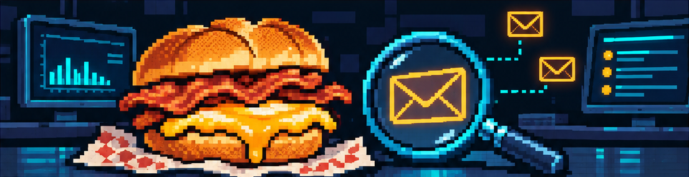

# Local draft: current mailbox state beside historical activity



This additive offline companion never collects from a tenant or modifies a saved case.

```sh
bec snapshot-import /path/to/bound-case /path/to/export.json --output /path/to/new-companion
bec snapshot-view /path/to/bound-case /path/to/new-companion
```

The case must have an exact native Microsoft directory GUID and the same lowercase primary mailbox UPN as the export. Unbound cases are refused, including demo cases. Create a separate explicitly bound synthetic case for testing. Synthetic is an exporter-supplied marker, not a proof of origin.

The accepted contract is `response-menu.mailbox-snapshot.v1`, with exactly these top-level fields: `schema`, `tenant_id` (GUID), `mailbox_upn` (lowercase UPN), `acquired_at` (ISO UTC), `synthetic` (boolean), `evidence_class` (`reserialized-source-objects`), and `sources`. Sources must contain `inbox_rules`, `forwarding`, and `delegates`; each has `status` (`collected`, `partial`, `denied`, or `unavailable`) and an array of opaque record objects. Denied/unavailable sources must have empty arrays. Delegate wrapper objects retain their producer source label and original object unchanged. No assumption is made about rule enabled state or maliciousness.

Imports preserve exact export bytes, including whitespace and BOM, in `snapshot.json`; a separate manifest stores the SHA-256, import time, original basename, mailbox/native tenant binding, synthetic marker and evidence class. JSON output gives source name, zero-based record index and JSON pointer for every object. These are hashes of **reserialized exported objects**, not original provider wire responses, and not independent authentication of what the exporter claims.

The view verifies both case raw evidence and companion bytes, then displays current snapshot sources separately from historical UAL rule activity matching the mailbox as normalized actor or target. Actor matches do not establish rule ownership; this deliberately conservative presentation is not a complete delegate-target resolver. Historical coverage remains visible even when no rule events match. Historical rule observations are filtered to the exact case interval [start,end). Undated or otherwise unparseable UAL observations are excluded from dated history and counted separately; that count is not necessarily rule-specific. Coverage describes the full retained UAL inventory. No state is reconstructed at incident time and no absence is treated as remediation.

Imports require a new output directory outside the case, bounded to 16 MiB and 10,000 objects. Duplicate JSON keys, malformed coverage, unsupported schema, mismatched/unbound native tenant, wrong mailbox, symlink source files, overwritten output and changed/tampered evidence are refused. An interrupted import can leave an incomplete companion directory; view refuses it. Retain it for inspection and choose another new output directory rather than overwriting it. The companion is not yet incorporated into BEC's standard case manifest, timeline HTML, compare, search, or replay commands; retain it alongside the original case.

GAM execution/import mappings and on-premises AD exports remain later phases. Existing native Google Reports support is unchanged. No live collection, credential changes, containment or remediation is included. Validate producers independently with authorized lab data before relying on this draft operationally.
